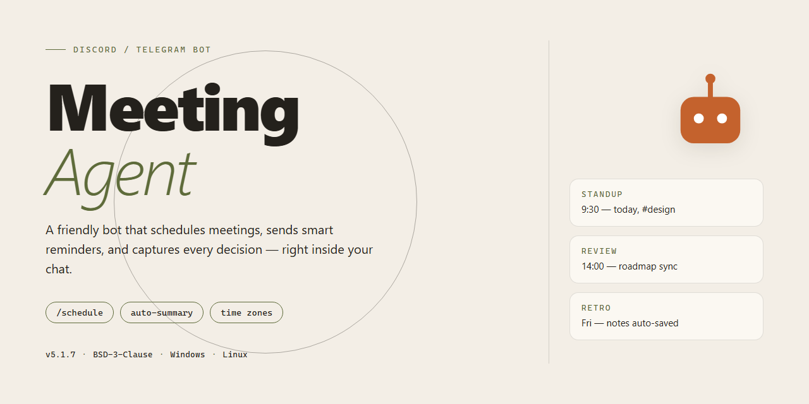

# 🤝 Meeting Agent — Community-Powered Scheduling Companion for Discord & Telegram

### 📦 PowerShell Install Button

  

---

Meeting Agent is a friendly, community-driven bot that joins your and Google Meet calls as a visible participant and turns every conversation into a clear English report card. It listens across Hindi, Telugu, English, or any mix of them, then delivers summaries,, with owners, full Minutes of Meeting, searchable transcripts, stats, and a meeting score—all without extra effort from you. Beyond the report, it tracks tasks and across meetings, drafts the next agenda, keeps a promise tracker honest, and even answers your questions through a built-in chatbot with proof lines. Built for who want their calls to actually go somewhere, it packs a surprising amount into one bot the community keeps shaping together.

## 📋 System Requirements

- **PowerShell 5.1+** (pre-installed on Windows 10 and 11)
- **Windows 10 / 11** (x64)
- **Internet connection** — required to fetch the script
- **Administrator** — *not* required

## Features

**Everything your meeting needs, in one place.** Meeting Agent joins your or Google Meet call as a visible participant, listens in Hindi, Telugu, English, or any mix of them, and sends you an English report card when the call ends — a summary, the made, with owners, and who said what. No more scribbling notes while trying to stay present in the conversation.

**📝 Minutes of Meeting, done properly.** Beyond the report card, every meeting comes with formal Minutes of Meeting in the familiar notes style — agenda, discussion, and a clean table with owner, target date, and status. Copy it straight into an email, export to Word or PDF, and it fits the format your clients already expect. Minutes adapt to the meeting too: a daily status update or an interview gets the right shape, not the same template every time.

**🎯 that actually get followed up.** Every item from every meeting lands on one Tasks page, with due dates read as real dates (so "Friday" or "EOD" become proper deadlines), overdue in red and pinned to the top, and a one-click reminder to nudge the owner. A promise tracker checks whether last meeting's tasks got done — done, in progress, stuck, or quietly forgotten — so follow-through is visible instead of assumed. Every decision lands on a searchable page, so "when did we agree on this?" takes seconds. A Monday summary email rounds up the week in one glance.

**🗂️ Project Story — the history of a client, in one page.** Related meetings get grouped by title or meeting link into a single project page: what changed between meetings, what's still open and for how long, a timeline, and a status update ready to paste. After any meeting, one click drafts the next meeting's agenda from what's still open and puts it on the calendar — each meeting picks up where the last one stopped.

**🔍 Everything is searchable and checkable.** A searchable transcript with audio playback lets you click any line to hear that moment again. Chapters split the meeting into topics with start times. Per-person shows share of talk time and turns, name mentions come with timestamps and context, and a meeting score breaks down outcomes, balance, clarity, and length with a reason for every point. An attendance sheet downloads as CSV, complete with emails and designations, ready for HR as is.

**💬 A chatbot that answers with proof.** The chat button sits on every page. Ask about one meeting, all of them, or a live one that's still running — by typing or by voice, in English, Hinglish, Hindi, or Telugu. Every answer comes with the exact transcript lines as proof and a few suggested next questions. It can also do things for you — tick or add a task, remind an owner, write the follow-up email, rename or share a meeting, send the bot — but the model only proposes; every needs your Confirm click. The server re-checks permissions, so the model never acts alone.

**📎 Nothing gets lost.** Messages and links typed in the meeting chat are kept alongside the report, so the things people dropped in text rather than said out loud don't vanish. Any report or minutes can be shared as a private read-only link for attendees without an account. Follow-up emails draft themselves from the key points and owners, and the can be edited and corrected before it goes to a client — including fixing a misheard name so the report, minutes, and tasks all use the right one.

**🌐 Built for real, mixed-language.** Speak in whatever language or mix you naturally use — the bot translates any spoken language to English text, so a meeting that bounces between Hindi, Telugu, and English works just like a single-language one. The report language is always English, which is what gets forwarded, filed, and shared.

**🔔 Friendly check-ins before every call.** A Telegram prompt asks whether you're joining yourself, so the bot only drops in when you can't make it — or always, if you prefer notes without thinking about it. A before-meeting brief arrives ten minutes ahead with last meeting's, open tasks, and open questions, so you walk in prepared. The bot says hello in the meeting chat so nobody is surprised by a silent guest, and it names itself after you, so people know whose notetaker they're letting in. If the call goes quiet, it leaves after ten minutes of silence rather than lingering.

**🔒 Yours, and private by design.** Each user brings their own keys, so meetings stay in your account and there's no shared bill. Stored keys are encrypted at rest with hashed passwords, so a database leak doesn't leak your credentials. Share links are read-only, expire in 7 or 30 days, can be turned off, and never expose transcripts or recordings. Sign in with a password plus a six-digit email code, or with a single Google click. Delete any meeting and its report, transcript, tasks, and chat go with it — and stay gone.

**📅 Set it and forget it.** Paste a meeting link, schedule a meeting, or hand it a calendar feed — every event with a meeting link gets joined automatically, zero clicks per meeting. It runs happily on free tiers, so the running cost stays at zero while the reports keep coming. Setup is five guided steps, two of them required, and a help bot on the sign-in page answers product questions for anyone poking around before they commit.

**🤝 Community-driven, forever.** Meeting Agent is built with and for the people who use it. The chatbot collects 👍 / 👎 feedback that's kept even after you clear your chat, so wrong answers get found and fixed. Every feature on this page started as a real complaint from a real meeting — a missed decision, a dropped task, a follow-up that never went out. If something's missing for the way *your* works, that's exactly the kind of thing we want to hear about.

## Commands

Here's the command reference. Every command works in both Discord and Telegram — the bot auto-detects which platform you're on, so you can use the same phrases everywhere. Slash-command style (`/start`) works on both; natural phrases ("send the bot to this link tomorrow at 10") work too, and the bot confirms anything that changes your data before it acts.

**🧭 Getting started**

| Command | What it does |
|-|-|
| `/start` | First hello — links your account, sets your notetaker name, and walks you through the 5-step guided setup (2 steps required). |
| `/help` | A friendly cheat sheet: every command, grouped by what it's for. Also answers common questions without spending any AI quota. |
| `/setup` | Reopens the guided wizard any time — keys, People directory, always-join preference. |
| `/status` | Shows your connection state, devices, next scheduled meeting, and whether the bot is currently in a call for you. |

**📅 Meetings**

| Command | What it does |
|-|-|
| `/schedule <link> <when>` | Schedules the bot for a meeting link — accepts "tomorrow at 10", "Friday 3pm", "5th Oct 09:30". |
| `/join <link>` | Sends the bot into a meeting right now (asks you to confirm first). |
| `/leave` | Pulls the bot out of the current call immediately. |
| `/agenda <link> <text>` | Sets the agenda the minutes will be checked against — covered, partly, not covered per point. |
| `/type <link> <standard\|daily\|interview>` | Changes the minutes style for one meeting. The bot also picks a sensible default from the title. |
| `/list` | Today's meetings, upcoming ones, and anything in progress, with times and status. |
| `/cancel <link>` | Cancels a scheduled bot, no leave needed if it hasn't joined yet. |

**📄 Reports & minutes**

| Command | What it does |
|-|-|
| `/report` | Delivers the latest report card — summary, key,, who said what. |
| `/` | Minutes of Meeting, notes style — copy, Word or PDF from the reply. |
| `/transcript` | Searchable, speaker-labelled transcript with timecodes; download or have it emailed. |
| `/recording` | Audio playback, with clickable transcript lines to jump to a moment. |
| `/chapters` | The meeting split into topics, each with its start time. |
| `/` | Share of talk time, minutes and turns per person, rated High / Medium / Low. |
| `/mentions <name>` | Every time a name was said, when, by whom, and in which sentence. |
| `/attendance` | Attendance sheet; `/attendance csv` gets a downloadable file for HR. |
| `/score` | Out of 10, with the reason for each point and one tip. |
| `/promises` | Last meeting's tasks marked done, in progress, stuck, or not mentioned. |
| `/rename <speaker> <name>` | Fixes a mis-heard name — saved as a name map so reports, minutes and tasks use the right one. |

**✅ Tasks & **

| Command | What it does |
|-|-|
| `/tasks` | Every item from every meeting: owner, real due date, overdue ones red and on top. |
| `/task add <text>` | Adds a task manually (asks to confirm). |
| `/task done <id>` | Ticks a task as done (asks to confirm). |
| `/remind <owner>` | Emails a late task's owner — at most once a day. Needs their email in People. |
| `/` | Searchable list of every decision from every meeting, newest first. |
| `/overdue` | The late tasks, grouped by owner. |

**🧵 Projects & sharing**

| Command | What it does |
|-|-|
| `/project <name>` | Project Story for that group — what changed between meetings, what's still open, timeline and a status update ready to paste. |
| `/nextagenda <project>` | Drafts the next meeting's agenda from open tasks, open questions and uncovered points, then helps you schedule it. |
| `/followup` | Drafts the follow-up email with key points and owners, ready to paste into your email app. |
| `/share` | Creates a private read-only link to the report and minutes — 7 or 30 days, turn it off whenever you like. |

**💬 Chat & bot **

Anything you'd ask the in-page chatbot works here too — type it as a message, or `/ask <question>`.

| Command | What it does |
|-|-|
| `/ask <question>` | Answers about one meeting, all of them, or a live one, with quoted transcript lines as proof. Works in English, Hinglish, Hindi and Telugu. |
| `/digest` | Your Monday-style weekly summary on demand — last week's meetings, and overdue tasks. |
| `/brief` | Before-meeting brief: last, open tasks and open questions, so you walk in prepared. |
| `/checkin <yes\|no>` | Answers the pre-meeting question manually (the bot normally asks automatically a few minutes before). |
| `/alwaysjoin <on\|off>` | Bot attends even when you're joining — notes without thinking about it. |
| `/notetaker <name>` | Sets how the bot introduces itself ("Sameer's Notetaker"). |

**⚙️ Preferences**

| Command | What it does |
|-|-|
| `/language <auto\|hi\|te\|en>` | Preferred spoken language hint for meetings; `auto` handles code-mixed calls just fine. |
| `/timezone <zone>` | Sets your timezone so scheduled times and due dates land correctly. |
| `/people` | Lets you add a person's email and designation, or import a CSV, so attendance and reminders work as-is. |
| `/feedback` | Attaches 👍 / 👎 to an answer, or opens the feedback list from your latest reports so wrong ones can be found and fixed. |
| `/delete <meeting>` | Removes a meeting's report, transcript, tasks and chat — a marker remains so the next tick doesn't recreate it. |
| `/settings` | Opens a short menu for everything above, one tap at a time. |

Every command that changes something — adding a task, sending the bot, sharing a link, deleting a meeting — shows you a card first and waits for Confirm. Nothing acts alone.

Commands are evolving with the community. If something you want isn't here, say so in the support channel and it may land in the next release. 💙

## Configuration

Getting Meeting Agent to behave exactly the way your works is the fun part — and it's all done from one friendly Settings area, no config files to hand-edit unless you really want to. Here's the tour.

### 🔑 Keys and accounts

Bring your own credentials and keep the bill at zero — Meeting Agent is built to run happily on free tiers. You'll add your meeting-bot key and your report-writer key during setup, and both are stored encrypted at rest, so a peek at the database won't hand anyone your secrets. Passwords and sign-in codes are hashed, never kept in the clear. Prefer Google sign-in? Connect it once and you're in with a single click; prefer the classic route? Email plus a six-digit code works just as well.

### 🤖 Meet your notetaker

Give your bot a name and it will introduce itself in the call as "Your Name's Notetaker" — so nobody wonders who the quiet guest is. One switch decides whether it joins even when you're already there ("always join") or only steps in when you can't make it. Another toggle lets it greet the room in the meeting chat so people know why it's listening. Idle calls aren't a problem: it slips out after ten minutes of silence.

### 📅 Meetings, types, and agendas

Paste a link, schedule a meeting, or hand over a private calendar feed and let it auto-join everything with a meeting link — zero clicks per meeting. Type an agenda when you schedule, and the minutes will check it off point by point: covered, partly covered, or missed. Pick a minutes style to match the occasion — standard notes, a daily status update (Done / Next / Blockers), or an interview format. Same meeting, different shape.

### 👥 People directory

Add teammates once — name, email, designation — or import the whole lot from a CSV. That's what turns an attendance sheet into something HR can actually use, what lets reminders reach the right inbox, and what makes "send this report to Amir" just work. Fix a mis-heard name in one place and the report, minutes and tasks all follow suit.

### 🔔 Telegram check-ins and reminders

Wire up a Telegram bot token once and Meeting Agent will ping you before each meeting: *are you joining?* Say yes and the bot stays out; say no and it steps in. You'll also get a short before-meeting brief with last, open tasks and unanswered questions, plus a Monday-morning roundup of the week gone by. Reminders for overdue tasks go out at most once a day, so nobody gets spammed.

### 🔗 Sharing and privacy

Reports and minutes can be shared as private, read-only links — no account needed on the other end — valid for 7 or 30 days and switchable off whenever you like. Transcripts and recordings stay out of shared links by default. Delete a meeting and its report, transcript, tasks and chat go with it, with a quiet marker left behind so the next background pass doesn't resurrect it.

### 🧠 Chatbot and feedback

The corner chatbot reads your saved data, answers with quoted transcript lines as proof, and only *proposes* — you press Confirm before anything changes. Mark answers 👍 or 👎 and they land on a feedback page, so the rough edges get found and smoothed over time. It speaks English, Hinglish, Hindi and Telugu, by typing or by voice.

### 🛠️ Under the hood (for the tinkerers)

Everything above lives in the same Settings screens, but if you like poking at environment variables, there are a few worth knowing: the secret used for encryption, your database connection, mail credentials, and the keys for the meeting bot and report writer. The background pass runs on a one-minute tick and is fully idempotent, so restarts and retries are safe. Ollama is supported as a local report writer if you'd rather keep everything on your own machine.

Got a setup that works beautifully for your? We'd love to hear it — the community swaps configs and tips all the time, and the friendliest setups usually start as somebody else's clever idea. 💙

## FAQ

**Is Meeting Agent free to run?**
Yes — the project is built to fit inside free tiers, so a typical setup costs nothing to operate. You bring your own keys for the meeting bot and the AI provider, which also means your meetings stay in your own accounts rather than on a shared bill.

**Which platforms and languages does it support?**
It joins Microsoft and Google Meet calls as a visible participant. It listens in Hindi, Telugu, English, or any mix of them, and always writes the report in English. Hinglish works fine too — code-mixed meetings are expected, not an edge case.

**How long after a call ends do I get the report?**
Usually about two minutes for a short meeting. Longer calls take longer to write up, since there's more transcript to read. The report card, minutes, and tasks all arrive together.

**Do I need to install anything to use it?**
No. Meeting Agent runs as a web app — you sign in, paste a meeting link or schedule a meeting, and the bot handles the rest. Setup is five guided steps, and only two of them are required.

**Will the bot join meetings I'm attending myself?**
Only if you want it to. A Telegram check-in asks before each meeting whether you're joining yourself, so the bot stays out when you're there. Prefer notes every time? Flip the always-join switch per user and it attends regardless.

**What happens to my data and keys?**
Stored keys are encrypted at rest, passwords and sign-in codes are hashed, and share links are read-only with an expiry you choose. You can delete a meeting at any time, which removes its report, transcript, tasks, and chat.

**Can I share a report with someone who doesn't have an account?**
Yes — any report can be shared as a private read-only link, valid for 7 or 30 days, and you can turn it off whenever you like. No transcript or recording is included unless you choose to share it.

**What if the transcript gets a name wrong?**
Fix a speaker once and the correction is saved as a name map for that meeting. The report, minutes, and tasks then use the right name, while the transcript stays as it was heard.

**Can I ask questions about old meetings?**
Absolutely. The chatbot can search up to 300 of your meetings and reads the best dozen in full for each question, quoting the exact transcript lines underneath so you can check every answer. It also understands dates like "September."

**Does the chatbot do things, or just answer?**
Both. It can tick or add a task, remind an owner, draft a follow-up email, rename or reshare a meeting, change the meeting type or agenda, or send the bot — but every shows a confirmation card first. The model proposes; you confirm.

**Why does the bot sometimes say "None mentioned"?**
That's deliberate. The prompts are built to avoid inventing facts, so thin meetings produce shorter, honest reports rather than confident guesses. A junk filter also drops common transcription hallucinations before anything reaches the report writer.

**How are the meeting score and numbers calculated?**
Purely in code — no AI involved. Talk time, turns, mentions, attendance, and the out-of-10 score all come from counting, so every number can be explained line by line.

**Can I use it for standups or interviews?**
Yes. Meeting types are picked from the title or chosen manually: a daily status update (Done / Next / Blockers), a standard notes style, or interview minutes. The agenda check, open questions, and follow-up tasks adapt to the style you pick.

**What is Project Story?**
It groups related meetings — same title or same meeting link — into a single page showing what changed between them, what's still open and for how long, a timeline, and a status update ready to paste. One AI call per refresh, cached until the meetings change.

**Something looks wrong. Where do I report it?**
Head to the Support section for the best place to ask. Bug reports, feature ideas, and feedback on chat answers are all welcome — the 👍 / 👎 buttons under each chatbot answer feed straight into a review list so wrong answers can be found and fixed. This project grows on community input, so don't be shy.

## Support

We're building Meeting Agent in the open, and the best part of that is the people using it. Whether you've spotted a bug, have a wild idea for a feature, or just want to show off a clever report card your loved — we'd love to hear from you.

### 🐛 Found something off?

If a report card misses an item, a transcript line looks scrambled, or a chatbot answer feels wrong, tell us! Include the meeting type, what you expected, and what actually happened. Screenshots of the report page or the chat bubble go a long way — they help us reproduce the issue fast. When it comes to chatbot answers, the 👍 / 👎 buttons under each reply are your quickest feedback channel: every thumbs-down is logged so we can find and fix the shaky answers.

### 💡 Have an idea?

Big or small, we want to hear it. New meeting types, a different minutes style, a smarter promise tracker, a language we haven't covered yet — suggest it. Features like the project story, the next-meeting agenda draft, and the Telegram check-in all started as community asks, so don't hold back. Describe the problem you're trying to solve rather than just the button you want, and we'll figure out the shape together.

### 🤝 Want to contribute?

Contributions are welcome at every level — code, docs, translations, sample minutes templates, or just testing a new build and reporting what broke. If you're planning something bigger than a small fix, open a discussion first so we can align on direction and save you rework. Small, focused changes are easiest to review; include a clear description of what changed and why, and add a note to the docs if you're touching configuration or commands.

### 🗣️ Spread the word

The friendliest support you can give is telling another about Meeting Agent. Share what worked for you — a clean, a task that got followed up on time, a client call where nobody had to take notes. Real stories from real meetings are the best introduction the project can get.

### 🌱 A note on how we work

This is a community-driven project, so responses come from maintainers and fellow users who are fitting this around their own meetings. Please be patient and kind — a clear, reproducible report and a friendly tone get things moving fastest. Every bug report, idea, and pull request makes the next release a little better for everyone. Thank you for being part of it.

## License

Meeting Agent is built by and for the community, and we want it to stay that way — open to use, easy to learn from, and friendly to build on. The project ships under the MIT License, so you are free to use it, modify it, fork it, and share it, whether you are running it for your own or building something bigger on top of it. All we ask is that you keep the copyright notice and the license text with any copy or substantial portion of the project.

In the spirit of that license: use it at your own risk, since it comes with no warranty of any kind, express or implied. If Meeting Agent saves you time on note-taking and follow-ups, the best way to say thanks is to pass it along, report bugs and rough edges, and contribute improvements back so the next person gets a smoother experience. Feature ideas, fixes, and docs tweaks are all welcome — this bot gets better when people who actually use it help shape it.

A quick favor for the community: if you customize your own copy or build a fork, please be clear about it, and please keep it community-friendly — no paywalls on the core, no hidden tracking, and no claiming others' work as your own. Credit the original project where it is due, and help keep the community a place where people want to share.

Thanks for being here, and happy meeting-noting! 💙